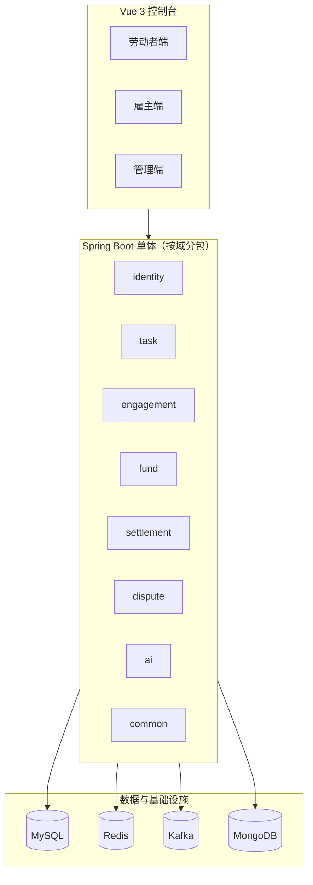

# 灵活用工任务结算与报酬托管平台

面向灵活用工场景的一体化平台：雇主发布任务并托管报酬，劳动者报名、签约、履约，验收后自动结算；争议进入平台仲裁，资金全程可追溯。

项目按生产系统的标准实现，重点不在页面数量，而在**资金一致性、状态机闭环、权限边界与可验证性**：每一笔资金变动都有复式分录，每一个状态迁移都有守卫，每一条对外承诺都有测试或验收脚本对应。

## 业务闭环

```
发布任务 → 冻结托管 → 报名 → 录用 → 签约 → 履约 → 验收 → 结算 → 打款
                │                                      │
                └──────── 撤单 / 到期退款 ─────────────┘
                                                       │
                                                  争议 → 仲裁 → 退款 / 放款
```

| 阶段 | 关键规则 |
|---|---|
| 发布 | 发布即托管：生成名额、冻结报酬、写托管单与分录在同一本地事务完成 |
| 报名 | 名额先到先得，条件更新保证并发下不超卖 |
| 录用 | 同一名额只能有一个有效录用；重复录用返回明确业务码 |
| 签约 | 合同条款快照，后续变更不回溯修改已签内容 |
| 履约 | 交付物、验收、驳回、重交形成完整记录 |
| 结算 | 服务费按万分比向下取整，与数据库 CHECK 约束对齐，差 1 分即失败 |
| 打款 | 打款单、尝试记录、通道结果、重试与人工复核分离 |
| 对账 | 日终对账、差异单、冲正、归档；差异必须有人处理，不自动抹平 |
| 争议 | 仲裁可冻结结算、调取聊天证据、执行退款或放款 |

## 界面

| 首页 | 雇主台 |
|---|---|
|  |  |

| 劳动者台 | AI 找活 |
|---|---|
|  |  |

## 技术栈

| 层 | 选型 |
|---|---|
| 语言与框架 | Java 17、Spring Boot 3.5.16 |
| 持久化 | MyBatis-Plus 3.5.18、MySQL 8.0.42、Flyway 23 个迁移 |
| 缓存与会话 | Redis 7.4、Spring Session、Caffeine 两级缓存 |
| 安全 | Spring Security、BCrypt、Redis 限流、四级授权 |
| 消息与异步 | Kafka（KRaft）、死信管理、发送失败降级写库 |
| 文档归档 | MongoDB 7（对账报文） |
| AI | Spring AI 1.1.8、DeepSeek 兼容接入、可切换 stub/live |
| 前端 | Vue 3.5、TypeScript 5.9、Vite 7、Pinia 3、Naive UI、Tailwind CSS 4 |
| 可观测性 | Actuator、结构化日志、traceId 全链路、AI 调用轨迹与成本台账 |

## 架构



七个业务域按 `api / application / domain / infrastructure` 四层组织，跨域只调用对方 `application` 层 Service。`common` 承载统一响应、异常映射、安全过滤器链、审计、通知、会话与聊天。

### 资金一致性

- 复式记账：批次 + 分录，批内借贷必平，分录只追加不修改。
- 余额是分录的派生结果，业务代码不直接更新余额列。
- 不变量校验：可用 + 冻结 = 总额；托管明细与名额一一对应。
- 幂等：业务单据号全局唯一，重复请求命中幂等键返回原结果。
- 并发：条件更新（`WHERE balance >= ?`），影响行数为 0 即失败；不启用版本号乐观锁。
- 对账：日终批次、差异单、冲正、人工复核四段分离。

### 状态机

任务、名额、报名、合同、托管单、打款单、争议各有显式状态机。状态只表达事实，**不作为业务守卫**；守卫直接判定名额集合、时间与资金状态，避免「状态字段写错导致越权操作」。

### 权限

- 一个账号可同时拥有雇主与劳动者身份，业务授权以身份表为准。
- 管理端按角色分级：客服、财务、仲裁、超级管理员，敏感操作二次校验。
- 401 与 403 分离；账号锁定返回 423，限流返回 429 + `Retry-After`。
- 管理端所有写操作留审计记录，包含操作人、对象、前后值与 traceId。

## AI 应用能力

AI 不是外挂的聊天框，而是嵌在「找人」和「问答」两条业务路径里的检索与生成链路：

```
口语查询 → 槽位解析 → 词法检索 → 规则/模型重排 → 抽取式答案 → 引用校验 → 轨迹与成本
```

| 能力 | 实现 |
|---|---|
| 查询理解 | 把「找个会装空调的，周末有空，三百以内」解析为结构化槽位 |
| 候选人检索 | 中文二元切分 + 同义词扩展 + 字段加权 |
| 重排 | 确定性融合分基线，模型重排可灰度；位移守卫超阈值整次作废 |
| 规则问答 | 只允许引用知识库片段原文，引用为空即弃答 |
| 推荐理由 | 模板化生成，每个字段可回溯到画像来源 |
| 降级 | 无 key / 模型异常时走 stub，接口照常返回并标 `degraded=true` |
| 成本 | 每次调用记录 token、耗时、是否回退、是否命中缓存；按日原子累加 |

离线评测的八项指标与复现方式见 [docs/ai-engineering.md](docs/ai-engineering.md)。核心结果：槽位 micro-F1 0.9948、NDCG@5 0.9898、HitRate@3 1.0、引用准确率 0.95、幻觉率 0、Judge 4.72（20 条 × 3 轮，`deepseek-chat`）。这些数字基于 10 人 fixture，只用于同语料、同 prompt 版本的回归对比，不代表线上效果。

## 测试与验证

```
mvn test
Tests run: 1061, Failures: 0, Errors: 0, Skipped: 97
```

- **964 条默认执行**：单元测试、Web 层契约测试、状态机与纯函数测试、 schema 契约测试。
- **97 条集成测试**：由 `ESCROW_IT=true` 门控，需要真实 MySQL/Redis；默认跳过，CI 的 `integration` job 单独执行。
- **前端**：`npm run typecheck` + `npm run build`，53 个页面组件全部参与类型检查。
- **端到端**：`scripts/verify-v12-e2e.ps1` 对真实后端做 22 项 HTTP 检查，覆盖注册、登录、会话、分页契约、越权 403。
- **AI 评测**：`AiEvalTest` 固定语料回归；`AiLiveEvalTest` 在配置 key 后回填 Judge 分数。

CI 分两个 job：`test` 跑默认测试与前端构建，稳定必过；`integration` 起 MySQL + Redis 跑 97 条真库测试，当前为 `continue-on-error`，观察期后再设为必过。

## 快速开始

### 依赖

- JDK 17、Maven 3.9+
- Node.js 22+、npm 10+
- Docker Desktop 或 Docker Engine + Compose v2

### 启动中间件

```bash
docker compose --profile core up -d
```

默认启动 MySQL 8.0.42 与 Redis 7.4。需要 Kafka 或 MongoDB 归档时追加 `--profile kafka` / `--profile v6`。

### 启动后端

```bash
mvn spring-boot:run
```

默认监听 `8080`，Flyway 自动建表。健康检查：

```bash
curl http://localhost:8080/actuator/health
```

### 启动前端

```bash
cd frontend
npm ci
npm run dev
```

默认监听 `5173`，开发代理指向 `http://localhost:8080`。

### 环境变量

复制 `.env.example` 为 `.env` 后按需修改。所有口令都有本地演示默认值（`dev_` 前缀），**不得用于任何真实环境**。真实口令只写在本地 `.env` 或部署环境变量里，仓库不保存任何凭据。

## 目录结构

```
src/main/java/com/escrow/platform/
├── identity/        账号、身份、资质、登录与会话
├── task/            任务草稿、发布、名额、检索
├── engagement/      报名、录用、合同、履约、验收、评价
├── fund/            账户、托管、分录、余额不变量
├── settlement/      结算、打款、重试、对账、差异处理
├── dispute/         争议、证据、仲裁、执行
├── admin/           治理看板、用户与资质管理
├── ai/              查询理解、检索、重排、问答、轨迹、成本
└── common/          响应体、异常、安全、审计、通知、聊天、缓存

src/main/resources/db/migration/   Flyway 迁移（23 个）
src/test/java/                     单元、契约、集成测试（158 个文件）
frontend/src/                      Vue 3 控制台（74 个组件，53 个页面、59 条路由）
scripts/                           本地验收与演示脚本
docs/                              需求、架构、AI、验证与决策记录
```

## 设计文档

| 文档 | 内容 |
|---|---|
| [docs/requirements.md](docs/requirements.md) | 154 条功能需求 + 33 条非功能需求，含验收标准 |
| [docs/tech-stack.md](docs/tech-stack.md) | 版本锁定与偏离规则 |
| [docs/version-history.md](docs/version-history.md) | V0 → V12.1 的范围、验收与风险 |
| [docs/architecture.md](docs/architecture.md) | 模块、数据模型、资金链路、状态机、权限 |
| [docs/ai-engineering.md](docs/ai-engineering.md) | AI 链路、评测口径、降级与成本 |
| [docs/verification.md](docs/verification.md) | 测试分层、运行方式、验收记录 |
| [docs/decisions.md](docs/decisions.md) | 架构决策记录（ADR） |
| [docs/limitations.md](docs/limitations.md) | 已知限制与后续演进 |

## 已知限制

- 支付通道为模拟实现，不接真实资金渠道；充值、打款、回调均为本地可控的模拟链路。
- 关键词检索为 `LIKE` + 词法匹配，没有向量召回；数据量上来后需要全文索引或独立检索服务。
- 任务详情缓存为进程内 + Redis 两级，多实例部署时本地层最长陈旧 60 秒。
- AI 评测语料为 10 人 fixture，指标只用于回归对比，不代表生产分布。
- 97 条集成测试需要真实 MySQL/Redis，默认跳过；未做多实例并发压测。

## 项目状态与来源

本仓库是 **v1.0.0 的发布快照**。项目在本地按 V0 → V12.1 逐版迭代，共 14 个版本，每版有独立的范围界定与验收结论；公开发布时导出为单个快照提交，因此提交历史不承载开发过程。

开发过程记录在仓库内容里，可逐条查证（计数均为 `src/main/java` 中的出现次数）：

| 证据 | 说明 |
|---|---|
| 23 个 Flyway 迁移 | `src/main/resources/db/migration/` 下按 `V1` → `V23` 严格递增，每个迁移只增不改 |
| 435 处 `@since Vn` | 标注每个类、方法引入的版本 |
| 429 处需求编号引用 | `FR-xxx` / `NFR-xxx`，可定位到 [需求规格](docs/requirements.md) 的 154 条功能需求与 33 条非功能需求 |
| 140 处决策引用 | 指向 [架构决策记录](docs/decisions.md) 的 31 条决策 |
| 版本演进 | [docs/version-history.md](docs/version-history.md) 记录每版的交付范围与验收结论 |

## License

[MIT](LICENSE)
